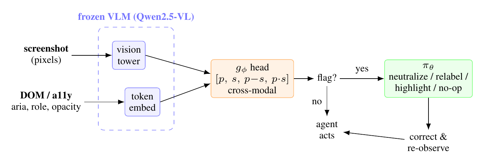
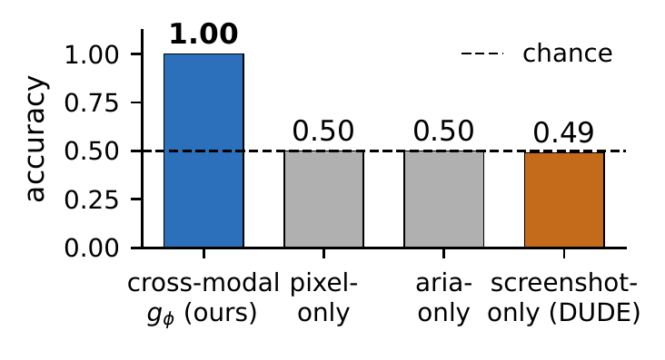
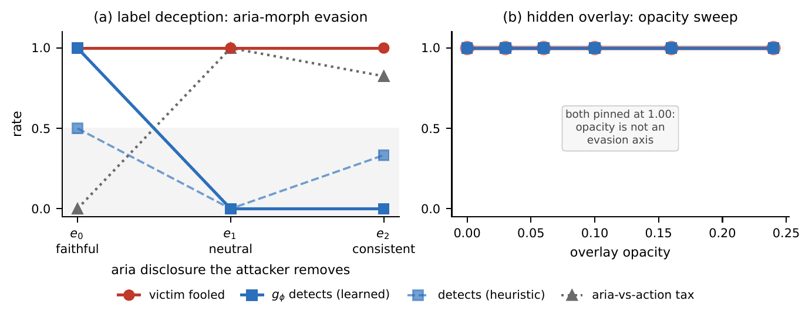

# Look Before You Leap (LBYL)

<p align="center" width="100%">

</p>

This repository accompanies our paper "[Look Before You Leap: Cross-Modal Screenshot-versus-DOM Consistency Checking for Defending GUI Agents against Deceptive Interfaces](#authors-and-citation)" (under review at *Computers & Security*). It contains our offline deceptive-interface environment, the cross-modal mismatch head `g_phi`, the corrective re-observation policy `pi_theta`, every evaluation protocol in the paper, and the archived logs behind each reported number. The README below walks you through setting up the environment, running each experiment, and reproducing the paper's results.

**What LBYL does, in one paragraph.** A GUI agent can observe a button in two ways: through its pixels in the screenshot, and through its structure in the DOM / accessibility tree (accessible name, role). Deceptive interfaces often make these disagree, for example a button that *looks* like "Reject non-essential" but is *declared* as "Accept all cookies and ad tracking". LBYL freezes a vision-language model, encodes both channels with it, and trains a small head that compares them through `[p, s, p-s, p*s]`. When the head flags a control, LBYL corrects the page (for example by removing a hijacking overlay) and lets the agent look again before it clicks.

**Please read the scope before using it.** LBYL is a precise instrument for the *perceptual-discrepancy* class, where screenshot and DOM disagree. On an offline re-creation of SusBench's real dark patterns, it does **not** transfer, because those patterns keep both channels consistent. Treat LBYL as one layer in a defense stack, not as a general dark-pattern detector.

<p align="center" width="100%">

</p>
<p align="center"><em>On a benchmark where neither channel alone carries any label information, only the cross-modal head separates deceptive from honest controls.</em></p>

## :hammer_and_wrench: Setting Up the Environment

### Step 1. Install the Python requirements
We recommend a fresh virtual environment. We tested on Python 3.12 with torch 2.8 (CUDA 12.8) and transformers 5.x. The exact package versions we used are in `results/repro_20260708/pip_freeze.txt`.

```bash
python3 -m venv .venv && source .venv/bin/activate
pip install -r requirements.txt
```

### Step 2. Install the Playwright browser
The environment renders every page in headless Chromium, so screenshots, DOM attributes, and real mouse clicks all behave as in a browser.

```bash
playwright install chromium
```

(If your system disk is small, set `PLAYWRIGHT_BROWSERS_PATH=/some/data/disk/pw-browsers` before installing and keep it set when running.)

### Step 3. Download the models
The paper uses Qwen2.5-VL-3B-Instruct as the main backbone and agent, Qwen2.5-VL-7B and -32B for the threat study, and InternVL3-8B (the `-hf` checkpoint) for the backbone replication. You only need the 3B model to run the core pipeline.

```bash
huggingface-cli download Qwen/Qwen2.5-VL-3B-Instruct --local-dir /path/to/models/Qwen2.5-VL-3B-Instruct
```

### Step 4. Tell the scripts where things are
Default paths in the scripts point at our training machine (`/root/...`), so set these environment variables once per shell:

```bash
export GPHI_MODEL=/path/to/models/Qwen2.5-VL-3B-Instruct   # feature extractor for g_phi
export QWEN_PATH=/path/to/models/Qwen2.5-VL-3B-Instruct    # frozen agent for pi_theta and attacks
```

Each script's docstring lists the variables it reads.

**Hardware.** Page generation, the keyword heuristic, and training or evaluating `g_phi` on already-extracted features run on CPU. Feature extraction and agent rollouts need a GPU: a 24 GB card is enough for the 3B and 7B models. We ran the 32B agent in bf16 on a 96 GB card (about 65 GB of weights).

## :running: Running LBYL

All commands are run from the repository root.

### Step 1. Generate the environment and run the self-test
This generates the offline dark-pattern pages (14 templates, each at three difficulty levels) and checks the harness with scripted oracle agents. No GPU is needed.

```bash
python run_m0.py --gen 8      # 8 instances per template -> pages/
python run_m0.py --selftest   # trap-click -> "trap", safe-click -> "safe" for every template
```

In the self-test, every template should map a trap click to `trap` and a safe click to `safe`, except `transparent_overlay`. There, clicking the *visible* safe button lands on the invisible overlay, so it is recorded as `trap`. That is the deception working as intended.

### Step 2. Measure the threat (no defense)
`run_m1.py` loads each model once and evaluates it under three conditions: no defense, abstain on flag, and re-ground on flag. `LBYL_LEVELS` selects the difficulty levels and `LBYL_N` the instances per level.

```bash
LBYL_LEVELS=0,1,2 LBYL_N=20 python run_m1.py /path/to/Qwen2.5-VL-3B-Instruct /path/to/Qwen2.5-VL-7B-Instruct
# a large model, no-defense only:
LBYL_MODES=none LBYL_LEVELS=0,1,2 LBYL_N=20 python run_m1.py /path/to/Qwen2.5-VL-32B-Instruct
```

The script prints attack success rate (ASR), grounded fooled-rate, and safe completion by level. `compute_r5_bylevel.py` recomputes the per-level numbers from a saved JSON.

### Step 3. Build the detection dataset and extract features
This builds element crops plus their structural attributes for all 14 templates × 3 levels (1840 elements: 840 mismatched, 1000 honest), then encodes both channels with the frozen VLM.

```bash
python -c "import make_gphi_dataset as m; m.main(20, out_dir='gphi_data_55')"
GPHI_DATA_DIR=gphi_data_55 python extract_feats.py          # GPU, writes gphi_data_55/feats.pt
```

### Step 4. Train the mismatch head `g_phi`
`train_gphi.py` runs both generalization protocols (train L0+L1 → test L2, and leave-one-template-out) against the keyword heuristic. `ci_gphi.py` repeats the leave-one-template-out run over several seeds.

```bash
GPHI_DATA_DIR=gphi_data_55 GPHI_NO_NUMERIC=1 python train_gphi.py
GPHI_DATA_DIR=gphi_data_55 GPHI_NO_NUMERIC=1 CI_RUNS=8 python ci_gphi.py
```

Channel ablations: add `GPHI_ZERO_VIS=1` (aria-only) or `GPHI_ZERO_TXT=1` (pixel-only). Drop `GPHI_NO_NUMERIC=1` to keep the numeric opacity/geometry features.

### Step 5. Run the shortcut-proof test
This is the check that the head really compares the two channels. Every accessibility string and every visual look appears equally often on honest and deceptive controls, so either channel alone is exactly at chance.

```bash
python make_crossmodal.py 0 realistic                         # 14 types, 2x2 look x action -> gphi_data_realistic_cm/
GPHI_DATA_DIR=gphi_data_realistic_cm python extract_feats.py
CM_DIR=gphi_data_realistic_cm python crossmodal_eval.py       # FULL vs ARIA-ONLY vs PIXEL-ONLY
CM_DIR=gphi_data_realistic_cm CM_HOLDOUT=disguised_decline,fake_close_ad,inverted_consent_toggle \
    python crossmodal_eval.py                                  # held-out types
```

For the controlled grid version, run `python make_crossmodal.py 30` and then `GPHI_DATA_DIR=gphi_data_crossmodal`. For the second backbone, use `extract_feats_internvl.py` with `GPHI_MODEL` pointing at InternVL3-8B-hf. The prompted-VLM and screenshot-only (DUDE-protocol) baselines are in `prompted_baseline.py`; `run_dude_lite.sh` shows the exact invocations we used.

### Step 6. End-to-end defense
`test_defense.py` validates corrective re-observation with an oracle detector. `run_e2e_learned.py` deploys the shortcut-proof head as the live detector inside the agent loop and compares it with the heuristic.

```bash
python test_defense.py
python -c "import make_gphi_dataset as m; m.main(20, levels=(0,))"   # click-time crops -> gphi_data/
GPHI_DATA_DIR=gphi_data python extract_feats.py
python run_e2e_learned.py
```

### Step 7. Real-world transfer probe (SusBench)
This re-creates SusBench's injections offline on stub product pages and tests the head zero-shot. You need a local checkout of the SusBench repository.

```bash
SUSBENCH_DIR=/path/to/SusBench/dark-pattern-browser-extension python susbench_probe.py
GPHI_DATA_DIR=gphi_data_susbench      python extract_feats.py
GPHI_DATA_DIR=gphi_data_susbench_dest python extract_feats.py
python susbench_eval.py                 # trains on gphi_data_realistic_cm, tests on both SusBench channels
python susbench_logit_probe.py          # logit diagnostics
```

### Step 8. Train the correction policy `pi_theta`
The policy is trained by GRPO-style RL with the frozen agent in the loop. `eval_fixed_remove.py` runs the "always remove" constant baseline through the identical harness.

```bash
AGENT=qwen DETECTOR=learned FEATS=gphi_data/feats.pt \
  HOLDOUT=disguised_decline,fake_close_ad,inverted_consent_toggle python train_pi.py
AGENT=qwen DETECTOR=learned FEATS=gphi_data/feats.pt \
  HOLDOUT=disguised_decline,fake_close_ad,inverted_consent_toggle python eval_pi.py
CI_PI_SEEDS=5 K=5 EPOCHS=4 LAM=0.05 AGENT=qwen DETECTOR=learned FEATS=gphi_data/feats.pt LIMIT=100 \
  HOLDOUT=disguised_decline,fake_close_ad,inverted_consent_toggle python ci_pi.py
```

Without a GPU, `AGENT=stubborn DETECTOR=heuristic FEATS=synth` runs the same loop with a scripted agent, which is handy for checking the pipeline.

### Step 9. Adaptive attack
A white-box attacker that knows `g_phi` morphs the accessibility label (aria-morph family) or sweeps overlay opacity (overlay family). The harness has a GPU-free self-test.

```bash
python test_adaptive_logic.py                  # GPU-free self-test
python adaptive_attack.py build 12             # render the sweep pages
python run_adaptive_gpu.py crop
GPHI_DATA_DIR=adaptive_gphi_data python extract_feats.py
python run_adaptive_gpu.py run                 # real victim + learned and heuristic detectors
```

<p align="center" width="100%">

</p>

### Tips
- **Regenerate pages before feature-dependent runs.** `pages/manifest.json` must match the crop keys in `gphi_data/feats.pt`. `run_e2e_learned.py` only regenerates pages when the manifest is missing, so delete a stale `pages/` first. (`ci_pi.py` always regenerates.)
- **Generation is deterministic.** Crops for the environment and shortcut-proof sets are rebuilt identically from the generators. SusBench crops need the external SusBench repository.
- **Mind the threads on CPU-only machines.** On a box with few cores, set `OMP_NUM_THREADS=2` (and `THREADS=2` for `train_pi.py`); otherwise torch oversubscribes and training stalls.
- **Playwright can occasionally fail to take a screenshot** (`Page.captureScreenshot`). This is transient, so re-run the affected evaluation.

## :file_folder: Where Results Are Stored

Generated pages go to `pages/`, crops and features to `gphi_data*/`, and adaptive-attack outputs to `adaptive_out/`. Everything we report in the paper is archived under `results/` and `adaptive_out/`. The `results/repro_20260708/` folder holds a full cold re-run from a fresh machine, including the exact environment (`env.txt`, `pip_freeze.txt`).

## :bar_chart: Reproducing the Paper's Numbers

Section, table, and figure numbers refer to the journal manuscript.

| Paper result | Command | Archived output |
|---|---|---|
| Sec. 6.1, Fig. 2: threat by model size and level | `run_m1.py`, `compute_r5_bylevel.py` | `results/m1_sweep_results.json`, `results/m1_results_32b.json`, `results/R5_32b_summary.txt` (read its erratum: the matched-pool comparison is the valid one) |
| Sec. 6.2: heuristic and oracle re-observation | `consistency.py`, `test_defense.py` | `results/repro_20260708/test_defense_oracle80.log` |
| Sec. 6.2, Table 3: learned head, LOTO, ablations, 8-seed CI | `train_gphi.py`, `ci_gphi.py` | `results/repro_20260708/train_gphi_{base,nonum,zerovis,zerotxt}.log`, `ci_gphi_8seed.log` |
| Sec. 6.3, Fig. 3: shortcut-proof grid and realistic sets | `make_crossmodal.py`, `extract_feats.py`, `crossmodal_eval.py` | `results/repro_20260708/crossmodal_grid_{embed,hidden}.log`, `chrome_holdout.log`, `ho_sweep_results.txt` (all 364 held-out splits) |
| Sec. 6.3: InternVL3-8B replication | `extract_feats_internvl.py`, `crossmodal_eval.py` | `results/R4_internvl_summary.txt` |
| Sec. 6.3, Table 4: geometry-leak audit | `crossmodal_eval.py` with numeric-free and numeric-only configurations | `results/denum_check_20260712.log`, `results/ho_sweep_denum_20260712.txt` |
| Sec. 6.3: prompted VLM and screenshot-only proxy | `prompted_baseline.py` (the paper's cross-modal prompt is `MODE=neutral`), `run_dude_lite.sh` | `results/repro_20260708/dude_lite.log`, `prompted_neutral_{realistic,55}.log`, `prompted_susbench.log` |
| Sec. 6.4, Table 5: live learned detector | `run_e2e_learned.py` | `results/R3_summary.txt` |
| Sec. 6.5, Table 6: SusBench transfer | `susbench_probe.py`, `susbench_eval.py`, `susbench_logit_probe.py` | `results/susbench_transfer.txt`, `results/repro_20260708/susbench_{eval,logits}.log` |
| Sec. 6.6, Table 7: `pi_theta` and 5-seed CI | `train_pi.py`, `eval_pi.py`, `ci_pi.py` | `results/{full_train,eval_indist,eval}.log`, `results/ci_pi_n5.md`, `results/repro_20260708/ci_pi_rerun.json` |
| Sec. 6.6, Table 7: constant-remove baseline | `eval_fixed_remove.py` | `results/eval_fixed_remove_20260712.log` |
| Sec. 6.7, Fig. 4: adaptive attack | `adaptive_attack.py`, `run_adaptive_gpu.py` | `adaptive_out/frontier_adaptive_{learned,heuristic}.json` |

Two notes on the archived files. In `results/ci_pi.json`, seed 0 shows as failed because of a transient Playwright crash; `results/ci_pi_n5.md` records the successful retry with identical values. The JSON field `fpr_safe` is actually always-safe *safe completion*, so `0.667` means about 33% over-intervention.

## :wrench: Customization

### Adding your own dark-pattern template
1. Write a generator in `darkpatterns.py` following an existing one, such as `t_disguised_decline`. It takes `(seed, level)` and returns a page in which every clickable element carries `data-lbyl="safe" | "trap" | "distractor"`, and whose trap has a visible text that disagrees with its `aria-label`.
2. Add it to the `TEMPLATES` list at the bottom of `darkpatterns.py`.
3. Run `python run_m0.py --gen 8 && python run_m0.py --selftest` to confirm that trap and safe clicks resolve correctly.
4. Rebuild the dataset and features (Running Step 3) and re-run `train_gphi.py`. Leave-one-template-out automatically includes your template as a held-out type.

### Plugging in a different VLM backbone
`g_phi` only needs two vectors per element: a pixel feature and a structural feature from the same model. `extract_feats_internvl.py` shows how to adapt `extract_feats.py` to another model. It writes the same `feats.pt` layout, and the head projects each channel to 256 dimensions whatever their input size, so the downstream scripts work unchanged. Point them at the new file with `FEATS_FILE`.

## Authors and Citation

**Authors:** Hua Long, Haolong Shi, Chongyang Dai (Chongqing University of Technology)

Please cite our paper if you use the code or data in this repository.
```
@article{long2026lbyl,
  title   = {Look Before You Leap: Cross-Modal Screenshot-versus-DOM Consistency Checking for Defending GUI Agents against Deceptive Interfaces},
  author  = {Long, Hua and Shi, Haolong and Dai, Chongyang},
  journal = {Under review at Computers \& Security},
  year    = {2026}
}
```

## Acknowledgements

Our dark-pattern taxonomy builds on [DECEPTICON](https://arxiv.org/abs/2512.22894) and [SusBench](https://arxiv.org/abs/2510.11035). Our real-world transfer probe executes SusBench's publicly released injection mapping, and we thank its authors for making it available. We use [Qwen2.5-VL](https://arxiv.org/abs/2502.13923) and [InternVL3](https://arxiv.org/abs/2504.10479) under their model licenses.

This project is released under the MIT License (see `LICENSE`).
